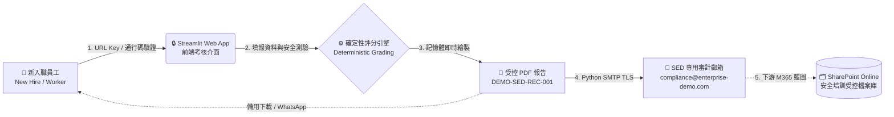

# 📝 企業入職安全訓練評估系統 Demo (EnterpriseDemo-Safety-Quiz)

[](https://jackylawck.github.io/EnterpriseDemo-Safety-Quiz/)
[](https://streamlit.io/)
[](#📄-合規與數據規範--compliance--document-standards)
[](#🛡️-架構與安全治理--architecture--governance)
[](./LICENSE)

**An Automated, Zero-Data-Retention Enterprise Onboarding Safety Assessment & Compliance Archiving System.**  
專為企業示範組織 (Enterprise Demo Corp.) 安全及環保組 (SED) 打造之新員工入職安全訓練評估與受控報告自動歸檔系統。

🌐 **專案展示主頁 / Project Showcase**: [https://jackylawck.github.io/EnterpriseDemo-Safety-Quiz/](https://jackylawck.github.io/EnterpriseDemo-Safety-Quiz/)

---

## 🌐 項目簡介 / System Overview

**EnterpriseDemo-Safety-Quiz** 是一個基於 Streamlit 開發的企業級入職安全訓練互動 Web 系統。系統專為安全及環保組（SED）設計，整合了 URL 免密參數門禁、動態載入安全考核題庫、記憶體即時合規 PDF 報告生成，以及後端 SMTP 一鍵自動發送歸檔功能，協助企業高效完成新員工入職安全訓練驗收與無紙化審計存證。

**EnterpriseDemo-Safety-Quiz** is an enterprise onboarding safety assessment web application built with Streamlit. Designed to streamline Safety & Environmental Department (SED) workflows, it integrates URL-key access control, dynamic JSON quiz loading, in-memory compliant PDF report generation, and one-click backend SMTP email delivery for paperless safety verification and audit archiving.

---

## 🏗️ 系統架構與數據流 / System Architecture & Data Flow

系統採用 **「零資料留存（Zero-Data-Retention）」** 設計，前端 Web 應用不設任何外置資料庫，所有個人資料僅於記憶體（Session State）內完成單次 PDF 渲染並透過加密通道直送指定審計郵箱，並可無縫銜接下游 Microsoft 365 自動化歸檔流程：



---

## 🛠️ 核心特色 / Key Features

* **兩階段引導式閉環流程 (2-Step Guided Closed-Loop Workflow)**
  * 採用 Session State 嚴謹控管「第一部分：安全考核測驗 ➔ 第二部分：一鍵提交與備份」，內建防重複寄信狀態鎖，確保流程順暢且具備操作不可否認性。
  * Enforces a structured two-step submission workflow with duplicate-submission locks to ensure assessment integrity and non-repudiation.

* **確定性即時自動評分 (Deterministic Real-Time Grading)**
  * 支援地盤職安健單選題考核，提交後即時計算得分與合格狀態（滿分 5 分，最少答對 3 條即 ≥60% 判定為 `PASS` / `FAIL`），不含黑箱演算法。
  * Evaluates safety responses via deterministic rules, instantly calculating scores and pass status (`≥ 3/5` or `60%` threshold) without opaque algorithms.

* **後端一鍵自動直寄 (One-Click Automated SMTP Delivery)**
  * 整合 Python 後端 SMTP（TLS 加密）模組，員工點擊按鈕後系統於背景自動打包成績摘要與 PDF 附件發送至 SED 電郵，徹底消除員工漏寄附件或忘記提交的人為疏失。
  * Integrates backend Python SMTP (TLS) to automatically package and transmit PDF reports to the SED inbox in a single click, eliminating manual attachment errors.

* **受控 PDF 報告生成引擎 (Controlled PDF Report Generation)**
  * 自動鎖定香港標準時間（UTC+8 HKT），將員工姓名、工人註冊證號碼、所屬組別、答題明細及誠信聲明繪製成標準受控 PDF 文件（`DEMO-SED-REC-001`），內建 UTF-8 繁體中文字型（Noto Sans TC）。
  * Embeds standardized HKT (UTC+8) timestamps, worker registration IDs, answer logs, and integrity declarations into printable, IMS-controlled PDF records.

* **企業級資安與動態題庫隔離 (Enterprise Security & Dynamic Secrets)**
  * 支援 URL 金鑰參數（`?key=...`）免密直達與手動通行碼雙模式驗證；通行碼、SMTP 發信憑證及 JSON 題庫/答案統一透過雲端環境變數（Secrets）隔離保管，公開原始碼庫 100% 零機密暴露。
  * Supports URL key parameter authentication alongside password fallback; access codes, SMTP credentials, and quiz JSON payloads are isolated in Cloud Secrets with zero source-code exposure.

---

## 📂 專案目錄結構 / Repository Structure

本專案採用「治理即代碼（Governance-as-Code）」架構組織，除核心應用程式外，亦完整納入合規聲明、JSON Schema 驗證規範及下游 M365 自動化藍圖：

```text
EnterpriseDemo-Safety-Quiz/
├── app.py                                   # Streamlit 核心應用程式 (門禁驗證、評分邏輯、FPDF 生成、SMTP 發信)
├── index.html                               # 專案展示與 SEO 結構化落地頁 (GitHub Pages Showcase)
├── requirements.txt                         # Python 依賴套件清單 (streamlit, fpdf)
├── NotoSansTC-Regular.ttf                   # UTF-8 繁體中文字型檔 (確保 PDF 中文無亂碼渲染)
├── COMPLIANCE.md                            # 綜合合規與國際標準治理評估說明書 (ISO / PDPO / GDPR / AI Act)
├── PRIVACY_POLICY.md                        # 個人資料私隱政策與零資料留存聲明
├── schemas/                                 # 資料治理與結構驗證規範 (JSON Schemas)
│   ├── questions_schema.json                # Streamlit Secrets 動態題庫結構驗證 Schema
│   └── sharepoint_sed_log_schema.json       # 下游 SharePoint 安全培訓追蹤清單資料結構規範
└── flows/                                   # 企業自動化工作流藍圖 (Workflow Blueprints)
    └── Flow_EmailToSharePointArchive.json   # M365 Power Automate 郵件附件自動歸檔至 SharePoint 藍圖
```

---

## 🚀 系統使用流程 / Application Workflow

1. **第一部分：入職安全訓練評估 (Part I: Safety Assessment)**
   * 員工透過內部專屬連結（附帶 `?key=...` 參數）或輸入通行碼進入系統。
   * 填寫**姓名**、**工人註冊證號碼**及**所屬組別**，完成 5 條地盤職安健評估試題並勾選「個人獨立完成聲明」。
2. **第二部分：一鍵提交與備份 (Part II: Submit & Archiving)**
   * 系統即時顯示考核得分與合格狀態（`PASS` / `FAIL`）。
   * 點擊 **「🚀 點此一鍵自動送出報告至 SED 電郵」**，後端即時打包受控 PDF 報告寄送至安環組審計郵箱。
   * 提供 **「💾 下載 PDF 報告」** 供員工本地留存備份，並附設 **WhatsApp 備用通訊管道** 應對極端網絡環境。

---

## ⚙️ 本地部署與 Secrets 配置 / Quick Start & Secrets Setup

### 1. 安裝依賴與啟動 / Installation & Run
```bash
git clone [https://github.com/jackylawck/EnterpriseDemo-Safety-Quiz.git](https://github.com/jackylawck/EnterpriseDemo-Safety-Quiz.git)
cd EnterpriseDemo-Safety-Quiz
pip install -r requirements.txt
streamlit run app.py
```

### 2. 配置 `.streamlit/secrets.toml` / Configure Secrets
在本地開發環境建立 `.streamlit/secrets.toml`（已加入 `.gitignore` 防止上傳），或於 Streamlit Community Cloud 後台貼入以下環境變數：

```toml
# 系統門禁通行碼
ACCESS_CODE = "demo2026"

# 郵件發送設定 (Python SMTP)
SMTP_SERVER = "smtp.office365.com"
SMTP_PORT = 587
SMTP_USER = "noreply@enterprise-demo.com"
SMTP_PASSWORD = "your-app-specific-password"
HR_EMAIL = "compliance@enterprise-demo.com"

# 動態考核題庫 (須符合 schemas/questions_schema.json 規範)
QUESTIONS_JSON = '''
[
  {
    "id": 1,
    "type": "single",
    "question": "1. 在什麼情況下需要配戴安全帽連帽帶？",
    "options": ["A. 進入地盤後任何時間", "B. 僅在高空工作時", "C. 僅在有安全主任巡查時"],
    "answer": "A. 進入地盤後任何時間"
  }
]
'''
```

---

## 📄 合規與數據規範 / Compliance & Document Standards

* **受控文件編號 (Document Control ID)**: `DEMO-SED-REC-001`
* **管理部門 (Issuing Department)**: 安全及環保組 / Safety & Environmental Department (SED)
* **合規門檻 (Pass Criteria)**: 最少答對 3 / 5 條（≥ 60%）
* **治理文件索引 (Governance Documentation)**:
  * 🛡️ [個人資料私隱政策 / Privacy Policy (`PRIVACY_POLICY.md`)](./PRIVACY_POLICY.md)
  * 📋 [綜合合規與國際標準評估 / Compliance Framework (`COMPLIANCE.md`)](./COMPLIANCE.md)
* **對標國際標準與法規 (Standards & Regulatory Alignment)**:
  * **ISO 45001:2018 (職業健康安全管理體系)**: 符合 Clause 7.2（人員能力與安全培訓驗證文件化紀錄）。
  * **ISO 9001:2015 (品質管理體系)**: 符合 Clause 7.5（IMS 受控文件編號與版本管理）。
  * **ISO/IEC 27001:2022 (資訊安全管理體系)**: 落實 A.9 存取控制、Secrets 憑證隔離、輸入消毒防護及零資料留存原則。
  * **個人資料（私隱）條例 (Cap. 486 PDPO) / GDPR**: 嚴格執行最小化資料收集與記憶體即時銷毀機制。
  * **EU AI Act / ISO/IEC 42001**: 本系統屬純確定性規則程式，無任何 AI/ML 模型，明確排除適用。
